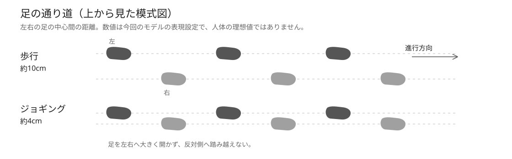
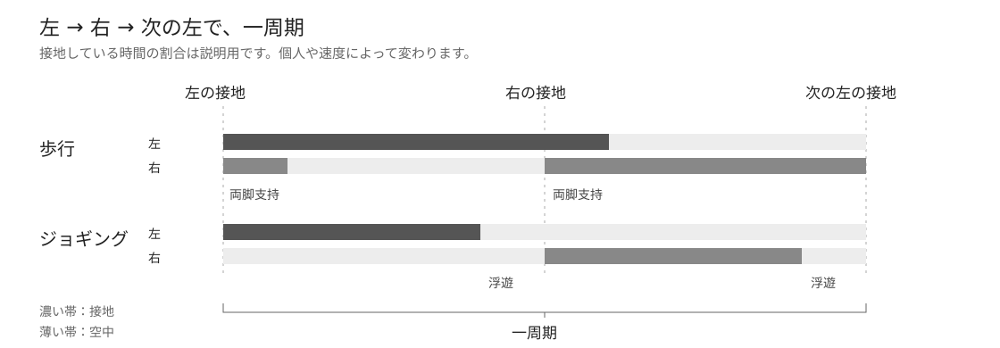

# 自然な歩行と、ゆったりしたジョギングを読む

歩行や走行の「きれいさ」は、一つの関節の角度だけでは決まりません。身体を無理なく支える姿勢、足へ体重を渡す順番、左右の脚と腕のつながりが、ひと続きになっていることが大切です。ここでは平地で前へ進む成人の、落ち着いた歩行と軽いジョギングを見ます。短距離走の全力疾走や競歩とは分けて考えます。

## 身体を起こし、肩と腕を楽にする

歩くときは目線を前へ向け、頭を起こします。首や肩をすくめず、背中を丸めて胸だけを前へ突き出す姿勢にも、腰を反らせる姿勢にもしません。Mayo Clinicの歩行ガイドは、首・肩・背中を緩め、肘を軽く曲げて自由に腕を振り、背中を前後へ反らさずに保つことを挙げています。[1]

腕は、反対側の脚と組み合わさって前後へ動きます。左脚が前へ出るときは右腕が前へ出る、というつながりです。脇を張って腕を左右へ振り回す必要はありません。胸郭や骨盤には歩みに伴う小さな動きがありますが、肩を意識的に大きく回し続けることが目的ではありません。普通の腕振りは小さな肩のトルクで行われ、腕を意図的に止めるよりエネルギー消費が小さかった、という歩行実験もあります。[2]

ジョギングでも、頭を水平に保ち、肩と腕を楽にします。Special Olympicsの長距離走指導は、腕を肩から無理なく前後へ振ることを勧めています。[3] 進む勢いに伴う前傾と、腰から折れてうつむく姿勢は、見た目にも違います。今回目指す軽いジョギングでは、上体を長く保ち、前のめりを強調しない姿を基準にします。これは今回選ぶ表現であり、すべての速度・競技の走りへ同じ角度を当てはめるものではありません。

## 足は身体の下へ運ぶ。狭くても、交差させない

正面から見ると、自然な歩行の足は、左右へ広げたまま平行移動しているわけではありません。支持する脚の上へ身体が移り、反対の足は前へ抜けて次の接地へ向かいます。膝とつま先が大きく外へ向き続ける姿や、左右へ大きく踏み出す姿とは区別できます。

走るときの足の通り道は、歩くときより身体の中心に近づきます。3m/sで10人を調べたArellanoとKramの研究では、走行時には狭い足幅が自然に選ばれ、腕振りと合わせて左右のバランスやエネルギー消費に関係していました。[4] ただし、「狭い」を「左右の足を完全に重ねる」と読む必要はありません。足幅の測り方、身体の大きさ、速度にも違いがあり、全員に同じ数値を押し付ける研究ではありません。

左右の足は進行方向に沿った近い通り道を通りますが、反対側へ踏み越えません。Special Olympicsの指導でも、正面から足の交差やつま先の外向きを確認するよう述べています。[3] つま先を一切外へ向けてはいけない、という意味でもありません。大きく開いた脚や、綱渡りのような交差を、普通のジョギングの標準にしないという見方です。

## 歩行は、踵からつま先へ体重を渡す

横から見ると、歩行では前へ出した足の踵が触れ、足裏が荷重を受け、身体がその足の上を通り過ぎます。やがて踵が上がり、前足部とつま先が最後まで地面を押して離れます。Mayo Clinicはこの流れを、踵からつま先へ滑らかに転がす歩き方として説明しています。[1]

支持する脚は、ずっと硬い棒のままでも、ずっと深く曲がったままでもありません。足へ体重を移すときの膝の動きと、身体を支えて前へ送る動きがつながります。地面を離れた脚は、膝を曲げて足を前へ運び、次の接地へ備えます。歩行には両足が同時に地面へ触れる短い期間があり、その間に前後の足へ体重を受け渡します。[5]

「足が地面から離れないこと」だけでは自然な接地にはなりません。踵と前足部がそれぞれ働く時間があり、体重が前へ進むにつれて足首とつま先の形も変わっていきます。

## ジョギングは、受け止めてから押し返す

ジョギングを横から見ると、接地した脚の膝や足首が曲がり、身体を受け止めた後に伸びて、次の一歩へつながります。Cappelliniらの研究では、歩行は比較的伸びた支持脚を身体が越えていく動き、走行は脚がばねのように曲がり伸びする動きとして示されています。[5] したがって、歩行の脚だけを速く動かしたものとは異なります。

速度にも目を向けます。Fukuchiらは28名のランナーを2.5・3.5・4.5m/sで計測し、多くの動作指標が速度に応じて変わることを示しています。[7] ゆったりしたジョギングを観察するときには、全力疾走の大きな脚の振り上げや身体の傾きを、そのまま理想像にしないようにします。

足を遠く前へ投げ出し、大きく突っ張って着地することが目標ではありません。Special Olympicsの指導は、無理のない歩幅とリズム、軽い膝の屈曲、滑らかな脚の動きを挙げています。[3] 接地する位置だけでなく、接地後に身体がどう沈み、どう前へ進むかを見ると、硬い走りと柔らかな走りの違いが分かります。

足のどこから触れるかには違いがあります。踵から触れる走り、中足部から触れる走り、前足部から触れる走りが実際に観察されています。Liebermanらの研究には、それぞれの側面映像と足圧映像が公開されています。[6] 前足部から触れた後に踵が下がる場合もあり、接地から離地まで前足部だけで立ち続けるとは限りません。

したがって「走るなら踵は絶対に着けない」とも、「足裏全体をずっと平らに貼り付ける」とも考えません。接地して荷重を受け、前足部へ体重を渡し、踵が持ち上がり、つま先が離れる時間の流れを見ます。走行では支持期間が歩行より短くなり、左右の支持の間に両足が地面から離れる期間が現れます。[5] 今回のモデルでは、短い浮遊を伴う軽いジョギングを選びます。

## 頭の上下動は、小さく滑らかにつなぐ

歩いている人の頭は、完全に同じ高さを滑るわけではありません。支持する脚の上を身体が通り、次の足へ荷重を渡すたびに、身体には上下の動きが生まれます。ただし、頭だけが大きく跳ねたり、着地の瞬間に急に落ちたりすると、落ち着いた歩みには見えません。横から普通の速度で見て、足への荷重が頭まで急な揺れとして伝わっていないかを確かめます。

上下動の数値を読むときは、**頭、体幹、骨盤、身体全体の重心を区別**します。頭の位置は観察する頭部の点、体幹は胸や背中などの位置、重心は全身の質量の分布から決まります。同じ量ではありません。Thorstenssonらは成人男性10名の歩行・走行を調べ、体幹に一周期あたり二回の上下動があり、その大きさや時期が速度と移動方法で変わることを報告しています。要旨にある2.5〜9.5cmは、その実験条件をまたぐ**体幹**の上下動の値であり、頭の理想値でも、どの速度にも当てはめる推奨範囲でもありません。[8]

頭を安定させる働きは、首だけで担うものでもありません。Limらの走行実験では、視線と頭の向きをより安定させる課題に対し、走る人は足を出すリズムや股関節・膝・足首の使い方を変えていました。頭部の加速度の変化と全身重心の上下動についての解釈は分けて報告されています。[9] 別の解析でも、頭と体幹の協調に加え、下肢関節の協調が変わり、体幹の上下動を減らすことに寄与すると考察されています。[10] 頭を空間に固定して首だけを伸び縮みさせるより、脚の受け止め、蹴り出し、骨盤と体幹の流れを一緒に見るのが、この資料から得られる観察の手掛かりです。

今回のマネキンでは、落ち着いた見え方を選び、平地の定速歩行・ジョギングともに、頭部の基準点の一周期の最高点と最低点の差を6cm以内にします。これは作品としての上限設定であり、研究が示す万人向けの正解ではありません。上下動をゼロにせず、接地から次の一歩までの変化を滑らかにつなぎます。

## 一歩と、一周期を区別する

左足が接地してから、右足が接地するまでが一歩です。左足が接地し、右足が接地し、左足が再び接地するまでが一周期です。同じ足に戻るまでを見ると、その脚が体重を受け、後ろへ抜け、空中を前へ戻り、次の荷重へつながる流れを観察できます。研究でも、同じ足の連続する接地の間を一周期として整理しています。[5]

歩行とジョギングのどちらも左右二歩を含みますが、接地している時間の割合が違います。歩行には両脚支持、今回のジョギングには浮遊が含まれます。下の図は、その違いを説明する模式図です。接地の割合は個人や速度によって変わるため、固定の正解値を示すものではありません。

連続した姿を見るときは、一つの格好だけを選ばず、横から接地と荷重、正面から足の通り道と膝、斜めから腕と全身のまとまりを見ます。映像をゆっくり見ることに加え、普通の速度で見たときのリズムも大切です。

## 今回のマネキンで選んだ表現

ここまでの説明は、人の動きを見るための参考です。次の数値と静止表現は、Walkersで採用するモデル・演出の設定であり、文献が定める人体の理想値ではありません。

| 項目 | 今回の設定 |
|---|---|
| 体型 | 身長1.78m、標準的な成人男性の実人体型。筋肉を誇張しないマットなマネキン |
| 立位 | 頭と体幹を起こし、腕を自然に下げた静止姿勢。肩や全身の待機揺れを加えない |
| 歩行 | 1.4m/s。左右の足の接地中心を約10cm離した通り道 |
| ジョギング | 2.8m/s。左右の足の接地中心を約4cm離した、交差しない狭い通り道 |
| 頭の上下動 | 平地定速の一周期で最高点と最低点の差を6cm以内とする演出上の上限。空間への完全固定は行わない |
| ジョギングの接地 | 足首・踵・前足部の動きと荷重の変化を示す。全接地期間を足裏の平面固定にしない |

足幅は左右の足の中心間の距離です。両足の内側の隙間や、足そのものの幅とは違います。モデルの比率、靴、速度、進む方向が変われば、この設定も見直します。

## 参考文献と映像

以下は本文の根拠と、実際の動きを観察するための資料です。ウェブ資料は2026年10月18〜19日に確認しました。本文の図2枚はWalkersで新規制作した模式図で、参考文献の画像・写真・映像の転載ではありません。

1. **Mayo Clinic Staff.（2026）** “Walking: Trim your waistline, improve your health.” Mayo Clinic. [本文と歩行姿勢図](https://www.mayoclinic.org/healthy-lifestyle/fitness/in-depth/walking/art-20046261)。参照箇所は“Consider your technique”と“Proper walking technique”。頭・肩・背中・腕振り・踵からつま先への運びを説明しています。
2. **Collins, S. H., Adamczyk, P. G., & Kuo, A. D.（2009）** “Dynamic arm swinging in human walking.” *Proceedings of the Royal Society B*, 276, 3679–3688. DOI: [10.1098/rspb.2009.0664](https://doi.org/10.1098/rspb.2009.0664)。[著者・本文・図](https://pmc.ncbi.nlm.nih.gov/articles/PMC2817299)。図3は普通の腕振り、腕の拘束、意図的な静止、逆位相の比較。10名の実験であり、腕の動きを一つの角度へ固定する指導ではありません。
3. **Special Olympics International.（2017）** *Athletics Coaching Guide*. [公式PDF、通算53ページ](https://media.specialolympics.org/resources/sports-essentials/coaching-guides/Sports-Essentials-Athletics-Coaching-Guide-2017-Version.pdf#page=53)。参照箇所は“Coaching Points — Long Distance Running Technique”と同ページの指導上の注意。歩幅、荷重移動、楽な腕振り、足の交差・つま先の外向きの観察を説明しています。短距離走の指導とは分けて読みました。
4. **Arellano, C. J., & Kram, R.（2011）** “The effects of step width and arm swing on energetic cost and lateral balance during running.” *Journal of Biomechanics*, 44(7), 1291–1295. DOI: [10.1016/j.jbiomech.2011.01.002](https://doi.org/10.1016/j.jbiomech.2011.01.002)。[論文情報と要旨](https://pubmed.ncbi.nlm.nih.gov/21316058/)。3m/s、10名、足幅と腕振りを変えた実験。自然に選ぶ狭い足幅と、左右のバランス・エネルギー消費の関係を調べています。
5. **Cappellini, G., Ivanenko, Y. P., Poppele, R. E., & Lacquaniti, F.（2006）** “Motor Patterns in Human Walking and Running.” *Journal of Neurophysiology*, 95(6), 3426–3437. DOI: [10.1152/jn.00081.2006](https://doi.org/10.1152/jn.00081.2006)。[本文と図](https://journals.physiology.org/doi/10.1152/jn.00081.2006)。図1は歩行・走行の支持と身体運動、図3上部は周期に沿った姿勢。Methodsの“Biomechanical analysis”に同じ足の接地から次の接地までという周期の定義があります。
6. **Lieberman, D. E., Venkadesan, M., Werbel, W. A., Daoud, A. I., D’Andrea, S., Davis, I. S., Mang’Eni, R. O., & Pitsiladis, Y.（2010）** “Foot strike patterns and collision forces in habitually barefoot versus shod runners.” *Nature*, 463, 531–535. DOI: [10.1038/nature08723](https://doi.org/10.1038/nature08723)。[論文とSupplementary information](https://www.nature.com/articles/nature08723)。Supplementary Movie 1–6は裸足・靴ありの側面接地映像、Movie 7–9は前足部・踵・中足部接地の足圧映像。着地の違いを観察する資料として参照し、特定の接地が万人に優れるという結論にはしていません。

7. **Fukuchi, R. K., Fukuchi, C. A., & Duarte, M.（2017）** “A public dataset of running biomechanics and the effects of running speed on lower extremity kinematics and kinetics.” *PeerJ*, 5, e3298. DOI: [10.7717/peerj.3298](https://doi.org/10.7717/peerj.3298)。[論文情報](https://pubmed.ncbi.nlm.nih.gov/28503379/)、[公式論文PDF](https://peerj.com/articles/3298.pdf)、[公開データ](https://doi.org/10.6084/m9.figshare.4543435)。図3は2.5・3.5・4.5m/sでの股・膝・足首の周期に沿った関節角度。28名を対象に速度による違いを調べています。論文はCC BY 4.0ですが、図表や計測データはこの配布物へ転載していません。

8. **Thorstensson, A., Nilsson, J., Carlson, H., & Zomlefer, M. R.（1984）** “Trunk movements in human locomotion.” *Acta Physiologica Scandinavica*, 121(1), 9–22. DOI: [10.1111/j.1748-1716.1984.tb10452.x](https://doi.org/10.1111/j.1748-1716.1984.tb10452.x)。[書誌情報と要旨](https://pubmed.ncbi.nlm.nih.gov/6741583/)。参照箇所は要旨の体幹の上下動・周期・速度依存性。10名の男性、歩行1.0〜2.5m/s・走行2.0〜6.0m/sを扱います。2.5〜9.5cmという値を頭部の測定値や理想範囲としては扱っていません。全文の図は参照・転載していません。
9. **Lim, J., Busa, M. A., van Emmerik, R. E. A., & Hamill, J.（2017）** “Adaptive changes in running kinematics as a function of head stability demands and their effect on shock transmission.” *Journal of Biomechanics*, 52, 122–129. DOI: [10.1016/j.jbiomech.2016.12.020](https://doi.org/10.1016/j.jbiomech.2016.12.020)。[要旨](https://pubmed.ncbi.nlm.nih.gov/28065472/)、[出版社の要旨・本文抜粋](https://www.sciencedirect.com/science/article/abs/pii/S0021929016313136)。参照箇所はAbstract、Participants、Head stability measures。12名のレクリエーションランナーによる、視覚課題を変えたトレッドミル走行の実験です。通常走行の頭部上下動の理想値を定めた研究ではありません。加速度・頭の向き・重心変位は別の指標として読みました。
10. **Lim, J., Hamill, J., Busa, M. A., & van Emmerik, R. E. A.（2020）** “Changes in coordination and variability during running as a function of head stability demands.” *Human Movement Science*, 73, 102673. DOI: [10.1016/j.humov.2020.102673](https://doi.org/10.1016/j.humov.2020.102673)。[要旨](https://pubmed.ncbi.nlm.nih.gov/32777666/)、[出版社の要旨・本文抜粋](https://www.sciencedirect.com/science/article/abs/pii/S0167945720305376)。参照箇所はAbstract、Results、Conclusions。12名の走行中の視覚課題に伴う頭・体幹・下肢の協調を調べています。頭の向きの安定、頭と体幹の協調、体幹の垂直方向の可動範囲を区別して参照しました。

これらの写真、図表、映像の権利はそれぞれの権利者にあります。配布物にはリンクと書誌情報を収録し、元画像・動画は同梱していません。新規図の扱いは[素材とライセンス](../THIRD_PARTY.md)を参照してください。
